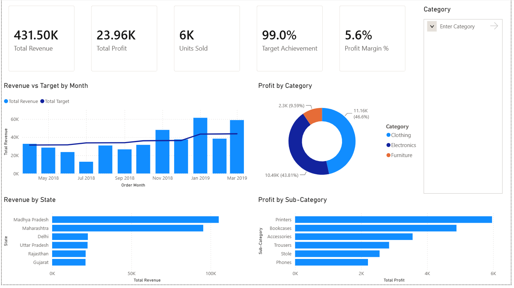

# E-Commerce Sales Analytics

End-to-end analytics project on an Indian e-commerce dataset covering **FY 2018–19**
(April 2018 – March 2019). Raw CSVs are cleaned in **Python/Pandas**, loaded into
**MySQL**, analysed in **SQL**, and visualised in a **Power BI** dashboard.

**Stack:** Python (Pandas, SQLAlchemy) → MySQL 8 → Power BI Desktop



---

## Dataset

Three source files, 2,036 rows total:

| File | Rows | Grain | Description |
|---|---|---|---|
| `List of Orders.csv` | 500 | One row per order | Order ID, date, customer, state, city |
| `Order Details.csv` | 1,500 | One row per line item | Amount, profit, quantity, category, sub-category |
| `Sales target.csv` | 36 | Category × month | Monthly revenue target per product category |

**Scale:** 500 orders · 1,500 line items · 332 customers · 24 cities · 19 states

### Data model

`Orders` joins to `Order Details` one-to-many on `Order ID` — verified with **zero
orphan records in either direction** (all 500 order IDs present in both tables).

`Sales Target` does not join directly to either table. It matches on **Category +
Month**, but `Category` lives in Order Details while the date lives in Orders — so
the two order tables must be merged first, then a month derived from `Order Date`,
before targets can be compared.

```
List of Orders ──── Order ID (1:many) ────► Order Details
   Order Date                                  Amount, Profit, Quantity
   Customer, State, City                       Category, Sub-Category
                                                        │
                        Sales Target ◄─── Category + Month
```

---

## Pipeline

### 1. Inspection (`inspect_data.py`)

Profiled row counts, dtypes, nulls and duplicates before touching anything.
Two findings drove the cleaning step:

- **60 fully-blank trailing rows** in `List of Orders.csv` — an Excel export
  artifact, not missing customer data. Pandas reported "60 missing values" in
  every column and "59 duplicate rows", which is one blank row plus 59 identical
  repeats. Real record count is **500**, not 560.
- **`Order Date` stored as `DD-MM-YYYY` text.** Left to infer the format, Pandas
  silently misparses day-first dates as month-first, corrupting any date beyond
  the 12th of a month.

### 2. Cleaning (`clean_data.py`)

| Step | Action |
|---|---|
| 1 | Drop fully-blank rows — `dropna(how="all")` → 560 → 500 rows |
| 2 | Parse dates with an explicit `format="%d-%m-%Y"` |
| 3 | Convert target months (`Apr-18`) to real dates via `format="%b-%y"` |
| 4 | Inner-join Orders → Order Details on `Order ID` → 1,500 rows × 10 cols |
| 5 | Derive a first-of-month `Month` column for target matching |
| 6 | Export `cleaned_sales.csv` and `cleaned_target.csv` |

### 3. Load to MySQL

`SQLAlchemy` + `PyMySQL` write both frames to the `ecommerce_sales` schema as
tables `sales` (1,500 rows) and `sales_target` (36 rows). Credentials are read
from the `MYSQL_PWD` environment variable rather than hardcoded.

### 4. SQL analysis

Aggregations by category, month and state, plus the actual-vs-target comparison:

```sql
SELECT s.Month,
       s.Category,
       SUM(s.Amount) AS actual_revenue,
       t.Target
FROM sales s
JOIN sales_target t
  ON s.Category = t.Category
 AND s.Month = t.`Month of Order Date`
GROUP BY s.Month, s.Category, t.Target
ORDER BY s.Month, s.Category;
```

### 5. Power BI dashboard

Connected via **ODBC** (MySQL Connector/ODBC). Power BI relationships match on a
single column only, so a composite key was built in both tables:

```dax
Key = sales[Category] & "-" & FORMAT(sales[Month], "YYYY-MM")
```

producing values like `Furniture-2018-04`, related one-to-many from
`sales_target` → `sales`.

**Measures:**

```dax
Total Revenue        = SUM(sales[Amount])
Total Profit         = SUM(sales[Profit])
Total Target         = SUM(sales_target[Target])
Target Achievement % = DIVIDE([Total Revenue], [Total Target])
Profit Margin %      = DIVIDE([Total Profit], [Total Revenue])
```

Because filters propagate from the "one" side to the "many" side, axis fields in
actual-vs-target visuals come from `sales_target`. Using the `sales` equivalents
would repeat the same total target against every bar.

---

## Findings

### Headline

| Metric | Value |
|---|---|
| Total revenue | ₹431,502 |
| Total profit | ₹23,955 |
| Profit margin | **5.6%** |
| Target achievement | **99.0%** |
| Units sold | 6,004 |

### 1. Furniture generates volume, not profit

Nearly a third of revenue produces under a tenth of profit.

| Category | Revenue | Rev % | Profit | Profit % | Margin |
|---|---|---|---|---|---|
| Electronics | ₹165,267 | 38.3% | ₹10,494 | 43.8% | 6.3% |
| Clothing | ₹139,054 | 32.2% | ₹11,163 | 46.6% | 8.0% |
| Furniture | ₹127,181 | 29.5% | ₹2,298 | 9.6% | **1.8%** |

### 2. Two sub-categories sell at a loss

| Sub-Category | Revenue | Profit |
|---|---|---|
| Tables | ₹22,614 | **−₹4,011** |
| Electronic Games | ₹39,168 | **−₹1,236** |

Tables alone erases roughly 17% of total company profit. Both sit inside
otherwise-healthy categories, so category-level reporting hides them entirely.

### 3. The 99% achievement figure is misleading

Aggregate performance looks near-target, but **7 of 12 months missed**:

| Month | Actual | Target | Achievement |
|---|---|---|---|
| Apr 2018 | ₹32,726 | ₹31,400 | 104.2% |
| May 2018 | ₹28,545 | ₹31,500 | 90.6% |
| Jun 2018 | ₹23,658 | ₹31,600 | 74.9% |
| **Jul 2018** | ₹12,966 | ₹33,800 | **38.4%** |
| Aug 2018 | ₹30,899 | ₹33,900 | 91.1% |
| Sep 2018 | ₹26,628 | ₹34,000 | 78.3% |
| Oct 2018 | ₹31,615 | ₹36,100 | 87.6% |
| Nov 2018 | ₹48,086 | ₹36,300 | 132.5% |
| Dec 2018 | ₹37,579 | ₹36,400 | 103.2% |
| Jan 2019 | ₹61,439 | ₹43,500 | 141.2% |
| Feb 2019 | ₹38,424 | ₹43,600 | 88.1% |
| Mar 2019 | ₹58,937 | ₹43,800 | 134.6% |

The business is strongly seasonal — weak April–October, strong November–March
(festive season and fiscal year-end). Targets rise steadily month over month,
ignoring that pattern, which is why they are missed for seven consecutive-ish
months and then overshot by 30–40%.

### 4. Revenue is geographically concentrated

Madhya Pradesh and Maharashtra together contribute **₹200,488 — 46% of all
revenue** across 19 states. Tamil Nadu is loss-making: **−₹2,216** profit on
₹6,087 revenue.

### Recommendations

1. **Audit Furniture pricing and discounting**, starting with Tables — the single
   largest profit drain.
2. **Reset targets seasonally** rather than on a flat upward slope; the current
   method makes performance look broken for half the year and inflated for the rest.
3. **Investigate Tamil Nadu** — the only state selling at a net loss.
4. **Protect the Nov–Mar window**, which carries the year.

---

## Repository

```
ecommerce-sales-analytics/
├── data/
│   ├── List of Orders.csv          # raw
│   ├── Order Details.csv           # raw
│   ├── Sales target.csv            # raw
│   ├── cleaned_sales.csv           # output of clean_data.py
│   └── cleaned_target.csv          # output of clean_data.py
├── images/
│   └── dashboard.png               # dashboard screenshot
├── inspect_data.py                 # profiling: shape, dtypes, nulls, duplicates
├── clean_data.py                   # clean → merge → load to MySQL
├── ecommerce.pbix                  # Power BI dashboard
├── ecommerce-theme.json            # Power BI theme (light)
├── ecommerce-theme-dark.json       # Power BI theme (dark)
├── .gitignore
└── README.md
```

## Reproducing

```bash
pip install pandas sqlalchemy pymysql
```

```sql
CREATE DATABASE ecommerce_sales;
```

```powershell
$env:MYSQL_PWD="your_password"
python clean_data.py
```

Then open `ecommerce.pbix` and refresh. The Power BI connection uses an ODBC DSN
named `ecommerce_dsn` pointing at the `ecommerce_sales` schema — create it via
**ODBC Data Sources (64-bit)** with the MySQL Unicode driver.

## Notes on the dashboard theme

Category colours were validated for colour-vision deficiency rather than picked
by eye: worst-case adjacent separation is ΔE 9.2 (light) / 9.4 (dark) under
deuteranopia simulation, against a target of ≥8. The dark palette uses
independently chosen steps rather than the light values reused, since colours
calibrated for a white surface lose contrast on a dark one.
